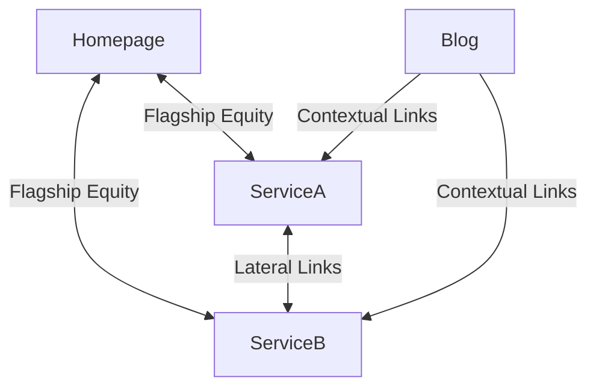

> **Template-data note:** This is a structural example, not a live keyword report. Search volumes, difficulty labels, trend labels and launch priorities in templates are placeholders/hypotheses. Revalidate them for the target market using the keyword-research protocol and Google Ads Keyword Planner data where available. No sequence is guaranteed to have the highest ROI.

# Site Architecture Templates — AI-Native Companies

## Template 1: AI Agency / Service Company

```
PILLAR: /ai-native-company (target: "ai native company", "ai-first company")
│
├── CLUSTER A: AI Agent Services
│   ├── /ai-agent-development     → "ai agent development", "build ai agents"
│   ├── /agentic-ai-platform      → "agentic ai", "agentic workflows"
│   ├── /multi-agent-systems      → "multi agent systems", "agent orchestration"
│   └── /autonomous-ai-agents     → "autonomous ai agents", "ai autonomy"
│
├── CLUSTER B: Technical Capabilities
│   ├── /rag-development          → "rag development", "retrieval augmented generation"
│   ├── /mcp-development          → "model context protocol", "mcp development"
│   ├── /ai-infrastructure        → "ai infrastructure", "LLMOps", "mlops"
│   └── /ai-engineering           → "ai engineering", "ai software development"
│
├── CLUSTER C: Business Applications
│   ├── /ai-automation            → "ai automation", "intelligent automation"
│   ├── /enterprise-ai            → "enterprise ai", "ai for business"
│   ├── /ai-transformation        → "ai transformation", "ai strategy"
│   └── /ai-consulting            → "ai consulting", "ai implementation"
│
├── CLUSTER D: Product Types
│   ├── /ai-product-development   → "ai product development"
│   ├── /ai-powered-saas          → "ai-powered saas", "ai saas development"
│   ├── /ai-startup-development   → "ai startup", "build an ai startup"
│   └── /ai-native-applications   → "ai-native applications", "ai-first apps"
│
└── BLOG/RESOURCES
    ├── /blog/what-is-agentic-ai          → Informational
    ├── /blog/ai-agent-use-cases          → Commercial investigation
    ├── /blog/mcp-explained               → Informational (trend status: verify current data)
    ├── /blog/rag-vs-fine-tuning          → Informational/comparison
    ├── /blog/multi-agent-system-design   → Technical deep dive
    └── /blog/ai-automation-examples      → Commercial investigation
```

## Priority Launch Sequence for AI Agency

**Example Phase 1 (validate demand, business fit, page readiness and effort before final ordering):**
1. /ai-native-company (pillar)
2. /ai-agent-development (validate commercial demand first)
3. /enterprise-ai (validate deal value and intent first)
4. /ai-automation (validate breadth and site fit first)

**Example Phase 2 (timing is illustrative; re-prioritize from live evidence):**
5. /rag-development (candidate; validate current trend and organic competition)
6. /mcp-development (candidate topic; verify demand, trend and competition first)
7. /agentic-ai-platform
8. /ai-consulting

**Example Phase 3 (timing is illustrative; re-prioritize from live evidence):**
9. /multi-agent-systems
10. /ai-infrastructure
11. /ai-transformation
12. /ai-powered-saas

**Blog content cadence (example only; size it to capacity and quality):**
- Publish at a pace the team can maintain with original, useful content.
- Use informational articles to support relevant service/product pages where user journeys connect.
- Link to the most relevant destination pages; don't force a fixed count per post.

---

## Template 2: AI SaaS Product

```
PILLAR: / (homepage, target: brand + "ai {category} platform")
│
├── PRODUCT PAGES
│   ├── /features                → "{product} features"
│   ├── /features/{feature-1}    → Specific feature keywords
│   ├── /features/{feature-2}
│   └── /pricing                 → "{product} pricing", "how much does {x} cost"
│
├── USE CASE PAGES
│   ├── /use-cases/{industry-1}  → "{product} for {industry}"
│   ├── /use-cases/{industry-2}
│   └── /use-cases/{role}        → "{product} for {CTO/dev/ops}"
│
├── COMPARISON PAGES
│   ├── /vs/{competitor-1}       → "{product} vs {competitor}" [HIGH INTENT]
│   ├── /vs/{competitor-2}
│   └── /alternatives            → "{competitor} alternative"
│
├── TECHNICAL PAGES
│   ├── /docs                    → Developer documentation
│   ├── /api                     → API reference
│   └── /integrations            → "{product} integrations"
│
└── TRUST/CONVERSION
    ├── /case-studies            → Social proof
    ├── /customers               → Customer logos
    └── /security                → Trust + compliance
```

---

## Internal Linking Rules for AI Companies

### Rule 1: Pillar ↔ Cluster Links
Where it helps the reader, link cluster pages to the relevant pillar and link the pillar to its important supporting pages. This is a useful architecture default, not a mandatory reciprocal link on every URL. Use descriptive anchors that explain the destination.

### Rule 2: Contextual Lateral Links
Link related clusters when the concepts or next-step user journey genuinely connect. For example, RAG development may link to AI agent development when the page explains the relationship. Do not add links merely to complete a diagram.

### Rule 3: Blog → Service/Product Links
Add a relevant service/product link when an article naturally supports that decision journey. Some informational articles may be better served by linking to documentation, a related guide, a tool, or no commercial CTA in the body. Avoid isolated valuable pages, but do not force irrelevant commercial links.

### Rule 4: Natural Anchor Text
Use concise, descriptive anchor text that makes sense in context. Variation can be natural across pages, but do not manufacture variants or repeat exact-match anchors mechanically. Anchor diversity alone does not guarantee protection from penalties.

### Rule 5: Useful Placement
Place a link where the reader can use it—near the explanation, claim, concept, or next step it supports. The first 200 words are not inherently a guaranteed SEO advantage; relevance and usability matter more than a fixed position.

---

## Content Calendar Template

| Priority | Page Slug | Primary Keyword | Monthly Volume Est | Difficulty | Owner | Target Publish |
|----------|-----------|-----------------|-------------------|------------|-------|----------------|
| 1 | /ai-native-company | ai native company | [fetch live demand] | [assess organic SERP] | | Month 1 |
| 2 | /ai-agent-development | ai agent development | [fetch live demand] | [assess organic SERP] | | Month 1 |
| 3 | /enterprise-ai | enterprise ai | [fetch live demand] | [assess organic SERP] | | Month 1 |
| 4 | /ai-automation | ai automation | [fetch live demand] | [assess organic SERP] | | Month 1 |
| 5 | /rag-development | rag development | [fetch live demand] | [assess organic SERP] | | Month 2 |
| 6 | /mcp-development | model context protocol | [fetch live demand] | [assess organic SERP] | | Month 2 |
| 7 | /agentic-ai-platform | agentic ai | [fetch live demand] | [assess organic SERP] | | Month 2 |
| 8 | /multi-agent-systems | multi agent systems | [fetch live demand] | [assess organic SERP] | | Month 3 |
| 9 | /ai-infrastructure | ai infrastructure | [fetch live demand] | [assess organic SERP] | | Month 3 |
| 10 | /ai-engineering | ai engineering | [fetch live demand] | [assess organic SERP] | | Month 3 |
| 11 | /ai-consulting | ai consulting | [fetch live demand] | [assess organic SERP] | | Month 4 |
| 12 | /ai-transformation | ai transformation | [fetch live demand] | [assess organic SERP] | | Month 4 |
| 13 | /ai-powered-saas | ai powered saas | [fetch live demand] | [assess organic SERP] | | Month 4 |
| 14 | /ai-product-development | ai product development | [fetch live demand] | [assess organic SERP] | | Month 5 |
| 15 | /ai-startup-development | ai startup development | [fetch live demand] | [assess organic SERP] | | Month 5 |

---

## Template 3: AI-Native Service Company (5-Pillar Model)
Based on the Webnox Digital architecture:
```
FLAGSHIP MAIN LANDING PAGE
└── / (Homepage: 'AI Native Company: [Value Proposition]')
    │
    ├── CLUSTER 1: Engagement Model & AI Talent
    │   ├── /forward-deployed-engineering     → 'forward deployed ai engineer' [candidate priority; validate data]
    │   ├── /dedicated-ai-engineering-pods    → 'hire ai agent developers' [candidate priority; validate data]
    │   └── /ai-readiness-audit               → 'enterprise ai readiness assessment' [candidate priority; validate data]
    │
    ├── CLUSTER 2: Autonomous AI Workforce & Agentic Systems
    │   ├── /ai-agent-development             → 'ai agent development agency' [priority: score from current data]
    │   ├── /multi-agent-systems              → 'enterprise multi agent systems' [candidate priority; validate data]
    │   └── /agentic-workflow-automation      → 'agentic workflow automation' [candidate priority; validate data]
    │
    ├── CLUSTER 3: AI-Native Software & Enterprise Architecture
    │   ├── /ai-native-software-development   → 'custom ai software development' [priority: score from current data]
    │   ├── /mcp-development                  → 'model context protocol' [trend status: verify current data]
    │   └── /agentic-rag-development          → 'enterprise rag development' [candidate priority; validate data]
    │
    ├── CLUSTER 4: AI-Native Growth & SEO (GEO/AEO)
    │   ├── /ai-native-seo-services           → 'generative engine optimization' [candidate priority; validate data]
    │   ├── /ai-video-production              → 'ai video generation service' [candidate priority; validate data]
    │   └── /ai-performance-marketing         → 'ai performance marketing' [candidate priority; validate data]
    │
    └── CLUSTER 5: AI Infrastructure & Operations
        ├── /llm-ops-observability            → 'llm ops observability' [candidate priority; validate data]
        └── /private-sovereign-ai             → 'private ai enterprise' [candidate priority; validate data]
```

---

## Blog Cluster Strategy Template with 12-Week Editorial Calendar
Template for organizing blog content into clusters with a week-by-week publishing schedule:

| Week | Target Blog Slug | Target Primary Keyword | Intent | Target Length | Internal CTA Target |
|------|------------------|------------------------|--------|---------------|---------------------|
| W1 | /blog/[pillar-1] | [highest validated opportunity based on business fit, demand and organic SERP evidence] | Informational | 3,000w | /[tier-1-service] |
| W2 | /blog/[pillar-2] | [rising topic] | Informational/Tech | 2,500w | /[related-service] |
| ... | ... | ... | ... | ... | ... |

---

## Bidirectional Link Equity Network Template


